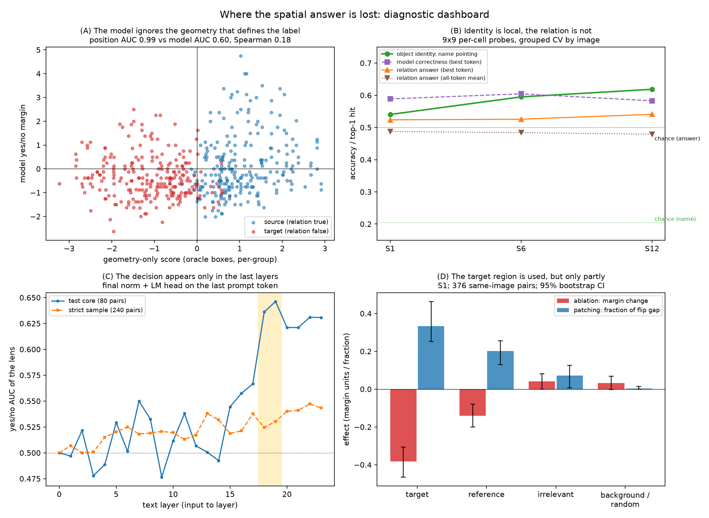
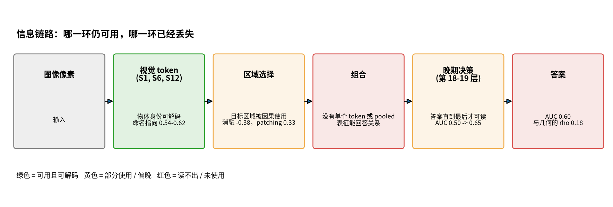
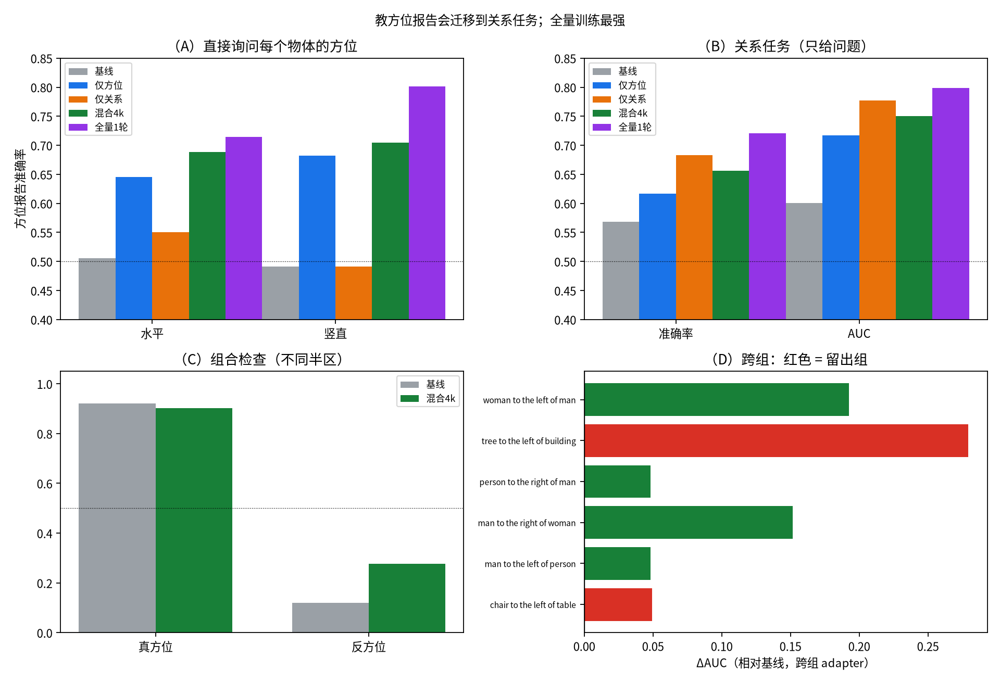
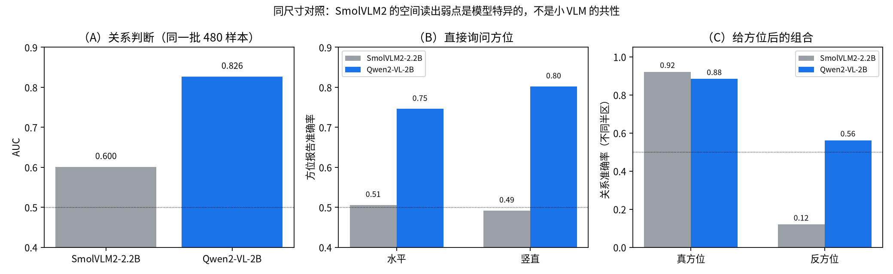
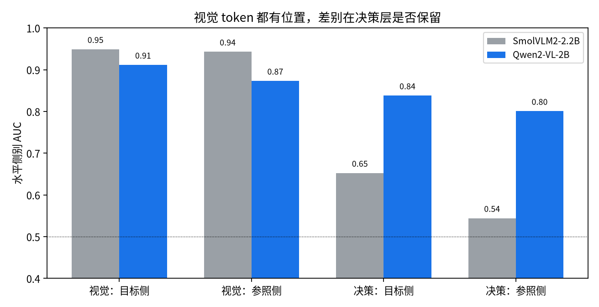

> **已过时：** 本文的 0.95/0.65 主结论在灰图仲裁后被证伪，修正版见 `report/findings_cn_v2.md`。

# 看得见却答不对：小型 VLM 的空间读出诊断（中文说明）

> 本说明汇总 2026-11-17/18 的实验结果，面向课程报告与组内汇报。
> 所有数字来自本地 SmolVLM2-2.2B-Instruct 的运行；原始 JSON 与复现命令见第 8 节。

---

## 0. 一句话

模型**能在视觉 token 里认出物体，也能在文字里完成方位推理，但它读不出物体在图像的哪一侧**；关系答案因此又晚又弱。针对“方位报告”做轻量监督，可以在不给任何关系标签的情况下改善关系判断，并在全新图像集上复现。

同尺寸对照进一步表明：**这不是所有小 VLM 的共性**。Qwen2-VL-2B（同为 2.2B）在同一批 480 个样本上关系 AUC 0.826、方位报告 0.75/0.80；SmolVLM2 的读出弱点是模型特异的。



---

## 1. 问题与数据

GQA 的平衡 yes/no 问题有一个混淆：回答“no”的题会移除参照物，模型可以靠“参照物不存在”答对。我们因此从 scene graph 重建受控配对：

- 同一个问题、两个不同图像：一个关系成立（正例），一个不成立（负例）；
- 目标物与参照物在图中都唯一、且框足够大；
- 标签由两个框的位置决定（2% 边距）；
- 图像级划分，训练/评测图像不重叠。

| 数据 | 规模 |
|---|---|
| dev | 1,206 对 / 494 图 |
| test core | 240 对 / 480 样本 / 6 组 |
| strict | 5,348 对 |
| 新确认集（train 留出） | 240 对 / 480 样本 |

核心 6 组都是左右关系：chair/table、man/person、man/woman、person/man、tree/building、woman/man。

---

## 2. 失败是任务特异的

同图细粒度对照 + 空白图控制：

| 任务 | 准确率 | 空白图 | 视觉增益 |
|---|---:|---:|---:|
| 存在性 | 0.865 | 0.455 | +0.410 |
| 属性 | 0.765 | 0.445 | +0.320 |
| 行为 | 0.865 | 0.715 | +0.150 |
| 空间关系（AUC） | 0.600 | 0.50 | +0.100 |

外部评测同向：POPE 0.783（不是乱说 yes 的幻觉型）、TIFA 空间事实 0.538 vs 提示回忆 0.692、TempCompass 方向 0.40/0.20 而动作 0.833/0.944。  
**结论**：不是“这个 VLM 不会看图”，而是空间、方向、时序特别弱。

---

## 3. 诊断链：信息在哪一环丢失



### 3.1 标签几乎由几何决定，模型却几乎不跟踪

按组用 12 维框特征训练一个简单分类器：**AUC 0.991**；模型自身 margin AUC **0.600**；两者 Spearman **0.183**，符号一致率 0.562。  
也就是说：答案几乎完全由两个框的位置决定，而模型的判断与这条规则基本脱钩。

### 3.2 物体身份在 token 上可解码

9×9 网格逐格训练 20 类物体名 probe，再问目标名/参照名的分数峰值是否落在各自框内：

| 阶段 | 两个物体平均命中 | 两个都对 | 随机 |
|---|---:|---:|---:|
| S1 | 0.540 | 0.317 | 0.205 |
| S6 | 0.595 | 0.358 | 0.205 |
| S12 | 0.619 | 0.398 | 0.205 |

物体身份是局部的、可解码的，而且随深度变好。

### 3.3 但关系不在单个 token 上

固定问句、每组 600 个平衡训练对，逐格 probe 预测“这张图是否满足关系”：

| 组 | 平均格准确率 | 最好格 | 模型自身 |
|---|---:|---:|---:|
| chair/table | 0.52 | 0.70 | 0.56 |
| man/person | 0.50 | 0.69 | 0.55 |
| man/woman | 0.53 | 0.71 | 0.65 |
| person/man | 0.51 | 0.68 | 0.59 |
| tree/building | 0.52 | 0.66 | 0.53 |
| woman/man | 0.52 | 0.69 | 0.55 |

平均仍接近随机；最好格 0.61–0.71，噪声很大。关系不是单个 token 能给出的。

### 3.4 决策状态缺水平位置

在答案形成的第 18–19 层，用 last-token 隐状态做线性 probe（按图像分组交叉验证）：

| 概念 | L12 | L16 | L18 | L19 | L20 | L23 |
|---|---:|---:|---:|---:|---:|---:|
| 目标在左半 | 0.523 | 0.594 | 0.622 | 0.653 | 0.647 | 0.633 |
| 参照在左半 | 0.487 | 0.553 | 0.566 | 0.544 | 0.555 | 0.519 |
| 目标在上半 | 0.768 | 0.805 | 0.795 | 0.792 | 0.789 | 0.773 |
| 关系答案 | 0.489 | 0.590 | 0.583 | 0.589 | 0.590 | 0.567 |

关键对比：**池化目标区域的视觉 token，水平侧别 AUC 0.95**（S1/S6/S12 = 0.949/0.943/0.948）。  
信息在视觉表征里，但决策状态（0.65）没有读到它。

### 3.5 生成端是方位先验

直接问“这个物体在左半还是右半？”：

- 水平：960/960 全部回答 “left”；把选项顺序反过来，933/960 仍是 “left”；
- 竖直：689/960 回答 “top”，准确率 0.492，低于真值多数类基线 **0.596**（776 top / 1144 bottom）。

也就是说，它不是在看框，而是在输出一个先验。

### 3.6 文字给出的方位可以被组合

把真实方位写进 prompt 再问关系：

| 条件 | 总体准确率 | 两物体不同半区（n=267） |
|---|---:|---:|
| 真方位 | 0.760 | **0.921** |
| 反方位 | 0.271 | 0.120 |

模型会跟着陈述翻转，说明**文字侧的组合电路是可用的**。  
注意：这不能证明自然视觉前向里的整个组合电路完好；能支持的说法是“主要失败位于定位/绑定 → 方位表征 → 文本读出这一段”。

### 3.7 决策出现得很晚

logit lens（每层 last-token 过 final norm + LM head）：

| 层 | 12 | 14 | 16 | 17 | 18 | 19 | 20 | final |
|---|---:|---:|---:|---:|---:|---:|---:|---:|
| base AUC | 0.507 | 0.493 | 0.557 | 0.567 | 0.636 | **0.646** | 0.621 | 0.634 |

前 14 层基本随机；信号在第 18 层才出现，正好是 24 层的最后四分之一。

### 3.8 目标区域被因果使用，但只承担三分之一

376 对同图翻转实验：

| 区域 | 消融造成的 margin 变化（S1） | patching 恢复的翻转差距（中位数） |
|---|---:|---:|
| 目标区域 | **−0.382** [−0.465, −0.306] | **0.333** [0.252, 0.464] |
| 参照区域 | −0.141 | 0.201 |
| 无关 / 随机 | +0.041 / +0.033 | 0.072 / 0.003 |

目标区域确实被使用，效应也特异；但只恢复约 1/3 的翻转差距，其余来自全局上下文、位置或语言先验。

---

## 4. 干预：教“方位报告”会迁移到关系

数据：2,954 张 GQA train 图；11,816 条方位问答 + 3,600 条关系问答。  
模型：SmolVLM2-2.2B，视觉塔冻结，LoRA r=8（2.57M 参数，0.11%），bf16，batch 1 + 累积 8，峰值 5.55GB，4,000 步约 14 分钟。



| adapter | 方位 水平/竖直 | 关系准确率 | 关系 AUC |
|---|---:|---:|---:|
| 基线 | 0.506 / 0.492 | 0.569 | 0.600 |
| 仅方位（无关系标签） | 0.645 / 0.682 | 0.617 | **0.717** |
| 仅关系 | 0.551 / 0.492 | 0.683 | 0.777 |
| 混合 4k | 0.689 / 0.704 | 0.656 | 0.750 |
| 全量 1 轮 | 0.714 / 0.802 | 0.721 | **0.799** |

三个结论：

1. **迁移成立**：只用方位监督、不给关系标签，关系 AUC +0.117 [0.071, 0.161]；第二个种子 +0.105 [0.060, 0.150]。
2. **方向不对称**：只用关系监督，方位报告停在 0.551/0.492——关系标签不会教位置读出。
3. **直接关系监督更强**（+0.177），但机制证据来自“仅方位”这一组。

---

## 5. 确认集与回归

新确认集：71,302 张未参与 SFT、也未出现在任何 pair 文件的 train 图；240 对 / 480 样本；图像级隔离（但 base 可能在预训练中见过）。

| 指标 | 基线 | 全量 adapter（seed 0） | 全量 adapter（seed 1） |
|---|---:|---:|---:|
| 确认集准确率 | 0.510 | **0.700** | **0.708** |
| 确认集 AUC | 0.531 | **0.802** | **0.804** |
| 翻转一致性 AUC | 0.750 | **0.821** | — |

ΔAUC = **+0.271 [0.215, 0.328]**。adapter 在确认集上的 0.802 与原 test 的 0.799 几乎一致，说明不是选择效应；反倒是基线在原 test 上的 0.600 偏乐观。

回归检查：

| 检查 | 基线 | 全量 adapter |
|---|---:|---:|
| POPE 准确率 / F1 | 0.783 / 0.732 | **0.850 / 0.852** |
| Fine-grained 总体 | 0.832 | 0.823 |
| 属性 | 0.765 | **0.805** |
| 行为 | 0.865 | 0.820 |
| 存在性 | 0.865 | 0.845 |
| 灰图对照 | 0.807 | 0.802 |

TIFA 是一个真实 trade-off：cued recall 0.753 → **0.867**，但自由描述 coverage 0.788 → 0.588，因为 adapter 更严格地遵守“一到两句话”（39.6 词 → 12.2 词）；要求四句话后 coverage 回到 0.702，仍比基线低约 0.086。不是知识退步，是风格/长度 + 少量内容质量。

adapter 的 logit lens：答案信号前移到 L17–18（0.667 / 0.831），最终 0.864（基线 0.634）。

---

## 6. 同尺寸对照：这是模型特异的，不是小 VLM 共性

模型：**Qwen2-VL-2B-Instruct**（2.2B，与 SmolVLM2 同尺寸；bf16，384² 像素上限）。  
协议：同一批 480 个样本、同一套 prompt、同一套评测代码。



| 指标 | SmolVLM2-2.2B | Qwen2-VL-2B |
|---|---:|---:|
| 关系准确率 / AUC | 0.569 / 0.600 | **0.746 / 0.826** |
| 方位报告：水平 | 0.506 | **0.746** |
| 方位报告：竖直 | 0.492 | **0.802** |
| 给真方位（不同半区） | 0.921 | 0.884 |
| 给反方位（不同半区） | 0.120 | 0.562 |



机制层也做了同样的侧别 probe：

| 水平侧别 AUC | SmolVLM2-2.2B | Qwen2-VL-2B |
|---|---:|---:|
| 视觉 token：目标侧 | 0.95 | 0.91 |
| 视觉 token：参照侧 | 0.94 | 0.87 |
| 决策层：目标侧 | **0.65**（L19） | **0.84**（L20） |
| 决策层：参照侧 | **0.54**（L19） | **0.80**（L20） |
| logit lens 最佳 | 0.646（L19） | 0.824（L20） |

三点观察：

1. **关系判断**：同尺寸的 Qwen2-VL-2B 在同一批样本上 AUC 0.826，六个组全部 ≥0.685；SmolVLM2 只有 0.600。
2. **方位报告**：Qwen 水平 0.746、竖直 0.802，预测分布有轻微 left 偏置（1340/580），但不是常数先验。
3. **组合与文本依赖**：Qwen 给真方位 0.884，给反方位仍有 0.562——它部分跟随文本、部分坚持视觉；SmolVLM2 则几乎完全被文本带走（0.120）。

结论：**两个模型都在视觉 token 里编码了水平位置（0.91–0.95），差别在决策层是否保留**——Qwen 保留到 0.84/0.80，SmolVLM2 掉到 0.65/0.54。  
所以“视觉可解码、决策读不出、生成先验”不是小 VLM 的普遍规律；在 2B 级别，空间读出是可以做到的，SmolVLM2 的弱点更可能是模型/训练数据特异，而不是规模上限。  
边界：这是两个不同模型家族的比较，不能把差异归因于单一架构或数据因素；它只说明“同尺寸可做到”，不说明“为什么 SmolVLM2 没做到”。

---

## 7. 这些结果能说明 / 不能说明什么

**能说明**：

- 失败是任务特异的，不是通用视觉失败；
- 标签由几何决定，模型几乎不跟踪；
- 物体身份局部可解码，但关系不在单 token 上；
- 水平位置在视觉 token 里（0.95），不在决策状态里（0.65），生成是方位先验；
- 文字侧组合可用；
- 教方位能迁移改善关系排序，并在新图像集上复现；
- 同尺寸 Qwen2-VL-2B 在同样任务上表现正常，且其决策层保留了水平侧别（0.84/0.80 vs SmolVLM2 0.65/0.54），说明这不是小 VLM 的规模共性，而是模型特异的读出弱点。

**不能说明**：

- 唯一瓶颈就是“方位读出”（定位/绑定/校准都可能贡献）；
- 视觉组合电路本身完好；
- 模型没有空间知识；
- attention 一般不重要；
- 提升能推广到其他模型、数据集、关系类型（Qwen 对照只说明“可做到”，不说明迁移）；
- 基准测的是“纯空间推理”（几何既是证据也是捷径）。

---

## 8. 复现与文件

| 内容 | 位置 |
|---|---|
| 诊断总览 / 链路图 | `results/figures/diagnostics_dashboard.png`、`diagnostics_chain.png` |
| SFT 结果图（中文） | `results/figures/sft_result_cn.png` |
| 逐格 probe 图 | `results/figures/per_token_probe_dev.png` |
| 诊断总结 | `results/diagnostics_summary.md` |
| SFT 总结 | `results/sft_summary.md` |
| 逐步实验日志 | `docs/sft_experiment_log.md` |
| 英文报告稿 | `report/report_v6_draft.md` |

```bash
python experiments/per_token_probe_map.py
python experiments/extract_side_features.py && python experiments/side_probe.py
python experiments/side_report.py
python experiments/side_given_relation.py
python experiments/logit_lens.py --max-pairs 240 --batch-size 2
python experiments/build_sft_data.py && python experiments/sft_lora.py
python experiments/eval_relation.py --adapter results/sft/adapter_full --tag full
python experiments/eval_relation.py --pairs data/derived/spatial_pairs_confirm.jsonl \
  --image-dir data/raw/gqa/train_all_images --max-per-group 40 \
  --adapter results/sft/adapter_full --tag confirm_full
```
