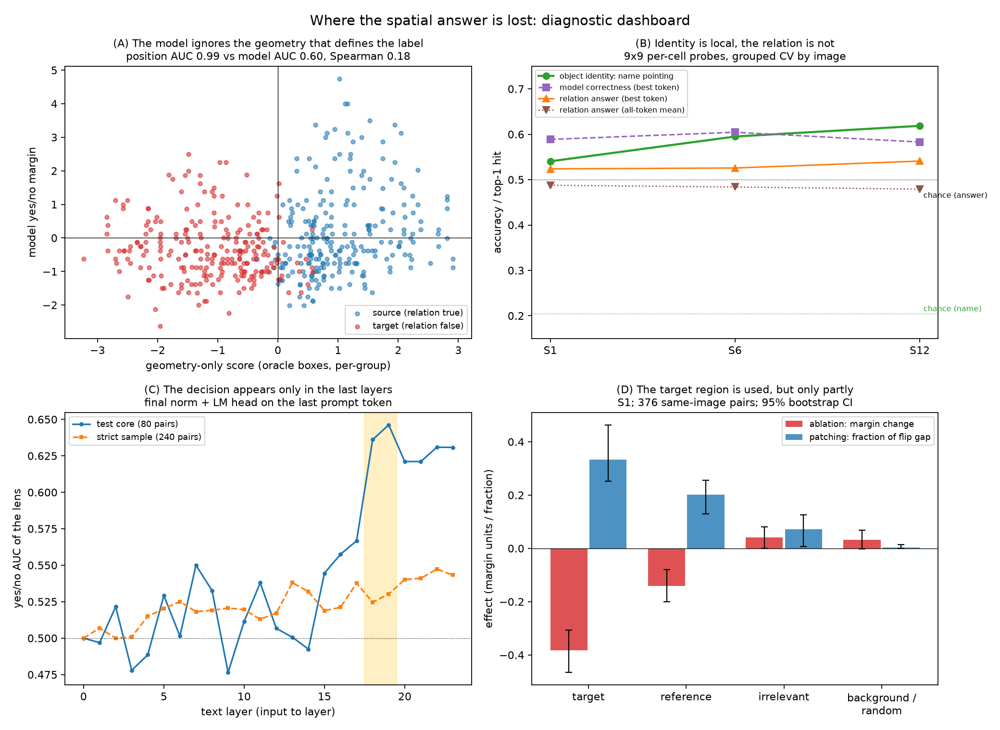

# 修正版：这套空间关系基准到底测了什么？

> 2026-11-18 修订。上一版 `findings_cn.md` 的主结论（“视觉里有 0.95 的方位、决策层只有 0.65，所以是读出瓶颈”）在灰图/打乱图仲裁后不成立。本文是修正后的版本，文献与复算均已核对。

---

## 0. 一句话

**这套 GQA 派生的左右关系题，大部分分数可以由“目标物体在图像的哪一半”解释；模型和 SFT 主要学到的也是这个绝对位置，而不是“比较两个物体”。**  
之前把“视觉 token 侧别 0.95”当作“信息在、读不出”的证据是错的：那个 probe 在纯灰图上反而更高（0.99），它读的是真值框的位置，不是物体内容。



---

## 1. 三个决定性复算

### 1.1 单框规则：不看参照物，也能到 AUC 0.871

只用目标框的绝对 x 中心，完全不看参照物：

| 指标 | base | side-only | relation-only | full | **单框规则** |
|---|---:|---:|---:|---:|---:|
| 总体 AUC（n=480） | 0.600 | 0.717 | 0.777 | 0.799 | **0.871** |
| 总体准确率 | 0.569 | — | — | 0.721 | **0.804** |
| same-half AUC（n=213） | 0.590 | 0.616 | 0.707 | 0.701 | **0.721** |
| diff-half AUC（n=267） | 0.611 | 0.794 | 0.831 | 0.866 | **1.000** |

读法：

- 总体 0.799 **低于**单框规则 0.871；一个不看参照物的规则比整个 adapter 还好。
- 两物体在同一半区（真正需要比较）时，full 0.701，规则 0.721；SFT 的 same-half 增益（base 0.590 → full 0.701）是真的，但只是追到“读绝对 x”的水平。
- 两物体分处不同半区时，规则 1.000，模型 0.866——模型的定位/读出反而不稳定。

### 1.2 视觉侧别 probe：灰图上更高

用真值框池化目标/参照 token，训练线性 probe 预测“在不在左半”：

| 输入 | S1 target-left | S6 | S12 | 说明 |
|---|---:|---:|---:|---|
| 原图 | 0.949 | 0.943 | 0.948 | 之前的“0.95” |
| **纯灰图** | **0.994** | **0.995** | **0.996** | 位置泄漏 |
| 打乱 16×16 patch | 0.983 | 0.986 | 0.982 | 布局被破坏仍高 |
| 遮住目标框 | 0.976 | 0.980 | 0.972 | 内容被移除仍高 |

结论：probe 读的是“被池化的 token 在图像的哪个位置”，不是物体内容。0.95 不能作为“视觉表征里有方位”的证据。  
这与 2026 年的 [Decodable Is Not Grounded](https://arxiv.org/abs/2606.31257) 完全一致：线性 probe + steering 会系统性高估 grounding，灰图仲裁是必要的。

### 1.3 Logit lens：信号变强，但没有前移

| 层 | 17 | 18 | 19 | 20 | 21 | 22 | 23 |
|---|---:|---:|---:|---:|---:|---:|---:|
| base AUC | 0.567 | 0.636 | 0.646 | 0.621 | — | — | 0.631 |
| full AUC | 0.667 | 0.831 | 0.847 | 0.852 | 0.854 | 0.854 | **0.860** |

full 的最佳层是 **L23（0.860）**，不是 L17–18。正确的说法是：**信号更早变得可读、且整体更强，但峰值仍在最后**；“决策前移”不成立。

---

## 2. 文献核对：哪些是真前作

评审提到的 2026 年论文全部真实存在，且与我们的主张直接重叠：

| 论文 | 年份 | 与本项目的关系 |
|---|---|---|
| [What's "up" with VLMs?](https://aclanthology.org/2023.emnlp-main.596/) | EMNLP 2023 | 空间失败 + 语言先验的经典基线；我们的 (a) 是复现 |
| [BLINK](https://arxiv.org/abs/2404.12390) | ECCV 2024 | “can see but not perceive”；标题与框架来源 |
| [SpatialEval](https://arxiv.org/abs/2406.14852) | NeurIPS 2024 | 文本 vs 视觉空间推理；我们的 (e) 是同类现象 |
| [Learning to Localize Objects](https://arxiv.org/abs/2404.07449) | CVPR 2024 | 坐标/定位监督提升空间推理；我们的 (f) 是它的一个变体 |
| [EmbSpatial-Bench](https://arxiv.org/abs/2406.12036) | 2024 | 具身空间基准；辅助定位消融 |
| [Why Is Spatial Reasoning Hard?](https://arxiv.org/abs/2503.01773) | 2025 | 注意力对齐物体位置；ADAPTVIS 训练-free 提升 |
| [Decodable Is Not Grounded](https://arxiv.org/abs/2606.31257) | 2026 | **直接前作/批评**：probe+steering 高估 grounding；灰图仲裁；14 个模型水平 grounded、竖直 prior、深度 inverted |
| [The Dual Mechanisms of Spatial Variable Binding](https://arxiv.org/abs/2603.22278) | 2026 | 视觉编码器是主源、全局分布；LM 中间层在 object token 上表示关系 |
| [Grounding Isn't Knowing](https://arxiv.org/abs/2608.23074) | 2026 | 分阶段 grounding→reasoning；位置先可解码、关系后出现；attention heads 介导 |
| [Visual Access Boundaries](https://arxiv.org/abs/2607.12815) | 2026 | 视觉信息在推理链中的可及边界 |

对我们的影响：

- (a) 任务特异：已知，BLINK/What's Up 已建立；我们的同图空白对照是更干净的复现。
- (b) 几何定标签、模型不跟踪：半新；SpatialEval 与 2025 注意力论文已指出语言/位置先验，我们的 0.991 vs ρ=0.18 是量化。
- (c) 身份局部、关系不在单 token：**不能这么说**。Dual Mechanisms 2026 在 object token 上读出了关系；我们的 probe 是池化 + 单 token，可能是假阴性。
- (d) 0.95 / 0.65 / 生成先验：**0.95 部分被证伪**（灰图更高）；生成先验仍成立；0.65 是 last-token 侧别，不能与 0.95 直接相减。
- (e) 文字给方位后组合：已知且偏乐观；SpatialEval 已显示文本可压过视觉；same-half 只有 0.559。
- (f) 仅方位监督迁移：**最像新结果的部分**，但 Learning to Localize / EmbSpatial 已证明定位监督可迁移；我们的 2×2 方向不对称（side-only 不教关系、relation-only 不教方位）是增量。
- (g) Qwen 正常→模型特异：**应降级为 family/training-specific**；Qwen2.5-VL-3B 4bit 0.817/0.687/0.619、SmolVLM2-500M 0.541，且 token 预算（81 vs 165）未对齐。

---

## 3. 仍然成立的结论

1. **受控配对协议是资产**：同问题、两图、一正一负、图像级隔离，比 GQA 原始 yes/no 干净。
2. **失败是任务特异的**：存在性 0.865、属性 0.765、行为 0.865，空间 0.600；空白图视觉增益 +0.41/+0.32/+0.15/+0.10。
3. **模型不能报告方位**：水平 960/960 “left”，选项反转仍 933/960；竖直 “top” 先验 0.492，低于真值多数类 0.596。
4. **给文字方位后模型会跟随**：真方位 0.760（不同半区 0.921），反方位 0.271（0.120）；但 same-half 只有 0.559，说明是“半区模式”，不是序关系比较。
5. **SFT 在 same-half 上有真实提升**：base 0.590 → full 0.701（AUC，n=213）；side-only 0.616（+0.026，CI 可能跨 0）。但 full 仍低于单框规则 0.721。
6. **跨模型**：Qwen2-VL-2B 0.746/0.826、方位 0.746/0.802；SmolVLM2-2.2B 0.600、方位 0.506/0.492。方向可信，但不能说“model-specific”。

---

## 4. 修正后的贡献定位

**不要写**：

- “发现了空间读出瓶颈”；
- “视觉里有 0.95 的方位，决策层只有 0.65”；
- “SFT 修复了关系判断”；
- “model-specific”。

**可以写**：

> 一个受控的同图配对协议，加上单框捷径与 same-half/diff-half 分解，说明这套 GQA 派生关系基准的分数主要由目标物体的绝对半区位置解释；模型与 LoRA-SFT 主要学到的是绝对位置读出，而不是序关系比较。方位监督可以迁移改善排序，但增益没有超过单框规则；文字侧组合可用，视觉序关系比较未建立。

这是一个**基准效度 + SFT 实际学到了什么**的负结果/方法学论文，而不是“机制发现 + 修复”。

---

## 5. 下一步（按优先级）

1. **reference-only counterfactual（决定性）**：目标不动，只把参照物移到另一侧；看 margin 是否翻转。2–3 天，8GB 可做。若不翻，模型确实不比较。
2. **同图换问句对**：同一张图问 “X 在 Y 左边吗？” 和 “X 在 Y 右边吗？”，标签由构造保证 1/0，position-only AUC 压到 0.5，才能测关系。
3. **position-matched probe**：同 box 换问句/换身份，使 position-only AUC=0.5，再看 region/last-token probe 是否还 >0.6。
4. **统计修正**：image-cluster bootstrap、Holm/FDR、n=40/组；主表并列 raw margin / flip / same-half / diff-half。
5. **报告重写**：按上面的“基准效度”叙事，三稿统一数字。

---

## 6. 图与文件

| 内容 | 位置 |
|---|---|
| 诊断总览 | `results/figures/diagnostics_dashboard.png` |
| 信息链路 | `results/figures/diagnostics_chain.png` |
| SFT 2×2（中文） | `results/figures/sft_result_cn.png` |
| 跨模型行为 | `results/figures/cross_model_cn.png` |
| 跨模型机制 | `results/figures/cross_model_probe_cn.png` |
| 单框/仲裁复算 | `results/diagnostics/probe_arbiter.json` |
| 旧版（已过时） | `report/findings_cn.md` |
| 英文稿（需按本文修正） | `report/report_v6_draft.md` |

```bash
python experiments/probe_arbiter.py          # 灰图/打乱/遮目标仲裁
python experiments/eval_relation.py --tag base
python experiments/eval_relation.py --adapter results/sft/adapter_full --tag full
```
