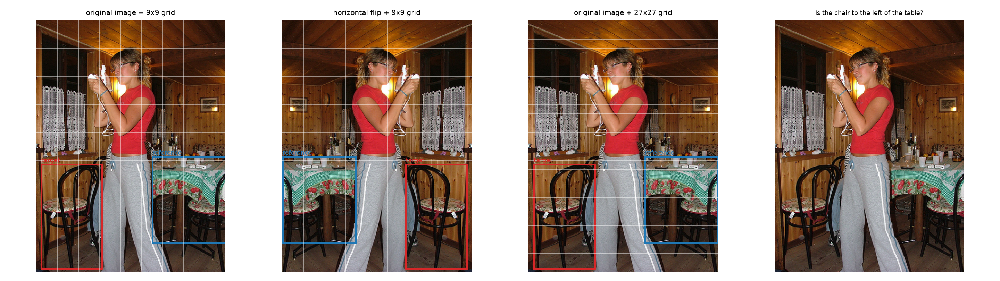
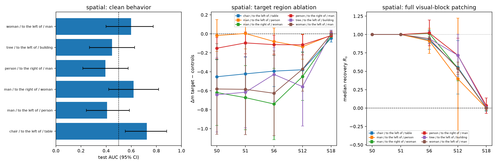
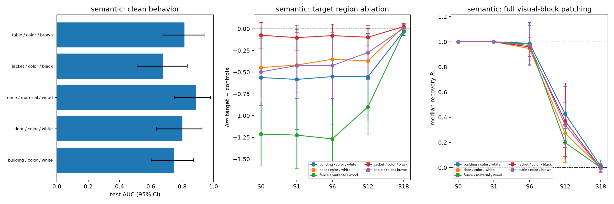
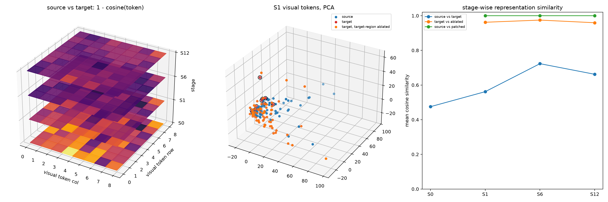

# From Visual Evidence to Decisions: Stage-wise Causal Tracing of Spatial Relations in a Vision-Language Model

*Draft report — experimental pipeline v5-pilot-1. All numbers are from the local SmolVLM2-2.2B-Instruct runs described below.*

## Abstract

We study where visual evidence becomes task-relevant in a small vision-language model. Rather than treating attention as an explanation, we combine clean behavior mapping, region-level mean replacement, and activation patching across five representative stages of SmolVLM2-2.2B-Instruct. Because GQA's balanced yes/no questions do not provide relation counterfactuals — every "no" `relVerifyCo` question removes the reference object — we construct canonical questions from GQA scene graphs and pair images that contain the same unique target and reference objects with opposite spatial relations. On held-out images, attribute-verification control tasks are robustly above chance. Without image splitting, only chair/table has a spatial AUC confidence interval excluding chance; with splitting, four of six spatial groups reach AUC 0.72–0.79 with intervals excluding chance, while two person/man groups remain at chance. Target-object mean replacement reduces the answer margin at early and middle stages (S0–S12) and disappears at S18; full visual-block patching recovers source evidence almost completely through S6, partially at S12, and not at S18. A same-image horizontal-flip counterfactual shows that regional target transfer is possible (`woman/man` \(R\approx0.46\), `man/person` \(R\approx0.38\)) but remains object-pair dependent (`chair/table` \(R\approx0.01\)), and shows that target ablation can shift the yes/no bias without destroying source–target discrimination. Whole-image linear probes at S0/S1 are close to chance. Object-region probes are higher (AUC 0.66–0.89 across stages), but a position-only baseline is higher still (0.86–0.99), so the region probe is dominated by bounding-box position and does not isolate relation information. The results support a conditional, failure-oriented account: semantic attributes show consistent margin separation and target-region output dependence; spatial behavior is resolution-sensitive and object-pair dependent. The stage-wise evidence alone cannot separate projection, binding, composition, and readout. A later diagnostic and intervention phase (Section 11) narrows this: pooled visual tokens decode an object's horizontal side at AUC 0.95, the layer-19 decision state only reaches 0.65, the model cannot report a side when asked (a constant "left"/"top" prior), and text-side composition works when the sides are supplied (0.92 on different-half examples). LoRA training on side questions alone transfers to the relation task (+0.117 AUC), and a full-epoch mixed adapter reaches 0.721 accuracy / 0.799 AUC on the original test and 0.700 / 0.802 on a fresh image-disjoint confirmation set. Full visual-block recovery remains a positive control, not evidence for a unique storage location.

## 1. Introduction and Research Scope

Vision-language models can answer questions about object attributes and spatial relations, but a correct answer does not show which internal stage formed the evidence or whether the answer used the image at all. This project asks a narrower question:

> When a question requires a target–reference spatial relation, at which stage does visual information become task-relevant, and how does it affect the final decision?

We distinguish four claims that are often conflated: (i) information is linearly readable from a representation; (ii) the output depends on that representation; (iii) the representation can transfer answer evidence across a counterfactual input; and (iv) the representation lies on the model's natural computation path. Our experiments address (ii) and (iii) directly, (i) only with a deliberately simple probe, and (iv) not at all.

The scope is a mechanism case study of one model and one GQA-derived task family. We do not claim a general mechanism for multimodal Transformers, a unique spatial-information location, or transfer to VLA control. The contribution is a validated pipeline, a necessary data-cleaning and task-construction correction, and a stage-wise characterization of where spatial evidence is and is not used. The canonical-pair construction is a methodological fix required by GQA's object-presence confound; it is not claimed as a validated research innovation.

## 2. Related Work and Evidence Levels

Work on attention as explanation warns that attention weights are not causal evidence [Jain & Wallace, 2019]. Probing work shows that decodability is not use, and that probes need control tasks and image-level splits [Belinkov, 2022; Hewitt & Liang, 2019]. Causal mediation and activation patching provide stronger evidence of dependence and transfer [Vig et al., 2020; Meng et al., 2022; Wang et al., 2022], but patching a full visual block is close to replacing the input and therefore needs regional and stage-wise controls.

Our design follows an evidence-level logic: clean behavior and input replacement first; regional mean replacement second; activation patching third; probes only to distinguish a specific alternative. A null probe is not evidence that information is absent.

## 3. Competing Explanations

We evaluate six non-exclusive explanations.

- **M1 Early visual evidence is insufficient.** Object or relation information is not readable from S0/S1, and later recovery is weak.
- **M2 Projection or early fusion loses information.** Information is present in the vision encoder but weakened after the connector or early language layers.
- **M3 Task-context binding fails.** Objects are present, but the model does not bind them to the current question.
- **M4 Relation composition is late.** Single-object evidence exists, but target–reference composition appears only in middle/late layers.
- **M5 Output calibration or language prior dominates.** Internal evidence exists but the yes/no decision is driven by prior or decoding.
- **M6 Distributed redundancy masks single-region interventions.** Small regions have little effect, while larger regions or full blocks do.

The experiments below do not uniquely identify one explanation. They narrow the space by showing which stages and regions have measurable output dependence, and which do not.

## 4. Model Pipeline, Data and Counterfactual Pairing

### 4.1 Model and stages

The main model is `HuggingFaceTB/SmolVLM2-2.2B-Instruct`. The language model has 24 layers, hidden size 2048, and 32 attention heads. The vision encoder has 27 layers. Without image splitting, the processor resizes each image to 384×384 and produces 81 visual tokens on a 9×9 grid; the connector maps the 27×27 vision grid (729 tokens, 1152 dimensions) to 81 tokens of 2048 dimensions. In a representative prompt the 81 image tokens occupy positions 5–85 of a 111-token input.

We use five stages:

| Stage | Hook | Shape | Interpretation |
|---|---|---|---|
| S0 | `vision_model.post_layernorm` output | 27×27×1152 | vision encoder output |
| S1 | `connector` output | 9×9×2048 | visual input to the language model |
| S2 | input to `text_model.layers[6]` | 111×2048 | ~25% depth |
| S3 | input to `text_model.layers[12]` | 111×2048 | ~50% depth |
| S4 | input to `text_model.layers[18]` | 111×2048 | ~75% depth |

S0 and S1 have different grids; region masks are computed separately (27×27 and 9×9). No stage is forced onto another stage's grid.

### 4.2 Why GQA testdev cannot support regional patching

The official GQA scene graphs cover train and val images only. The 398 testdev images used in the original plan have **0/398** coverage in both `train_sceneGraphs.json` and `val_sceneGraphs.json`. Without bounding boxes, region-level patching on testdev is impossible. We therefore use `val_balanced`, whose 10,234 question images have 100% scene-graph coverage.

### 4.3 Natural pairing is structurally impossible

GQA balanced `relVerify`/`relVerifyCo` questions are not relation counterfactuals. In every simple `relVerifyCo` "no" question, the reference object is written as `(-)`, meaning the object is absent. Counting simple spatial `relVerify`/`relVerifyCo` questions:

| Pool | yes with reference present | no with reference absent | same question, both objects present, opposite labels |
|---|---:|---:|---:|
| testdev balanced | 209 | 172 | 0 |
| testdev all | 3,145 | 2,320 | 0 |
| val balanced | 2,207 | 2,048 | 0 |

Natural exact-question pairs do not exist at scale. This is a property of GQA's generation procedure, not a sampling limitation. It also means that using GQA balanced pairs to study spatial relations conflates relation truth with object presence. The machine-readable audit is in `results/audit/gqa_pairing_audit.json`; the script is `experiments/audit_gqa_pairs.py`.

### 4.4 Canonical question construction

We construct GQA-derived canonical questions from scene graphs. For a spatial group `(A, r, B)`, the question is `Is the A r the B?`, where A and B are object categories with exactly one instance in both images and `r` is one of `to the left of`, `to the right of`, `above`, `below`. Truth is determined from bounding-box centers with a 2% image-size margin; near-ties are excluded. A source image has `r` true, a target image has `r` false, and both images contain unique A and B. The question text, candidate set (yes/no), text token structure, and no-split visual sequence shape (81 tokens) are identical across the pair.

For semantic control, we use scene-graph attributes. A group `(A, dimension, value)` asks `Is the A value?` (or `Is the A made of value?`); positive images have the attribute and negative images have a different value in the same dimension. Both images contain a unique A.

The dataset uses a deterministic image-level split: `sha1(image_id) % 5 == 0` is dev (20%), otherwise test. Source and target images of a pair are always in the same split. The selected groups were frozen on dev before test evaluation.

Figure 1 illustrates the construction for `chair/left/table`: the original image has the chair to the left of the table, the horizontal flip preserves scene and objects but reverses the relation, and the target/reference boxes are mirrored exactly. The 9×9 grid is the S1 visual-token grid; the 27×27 grid is the S0 vision-encoder grid.

| Task | Groups | Selected dev pairs | Selected test pairs | Test pairs/group |
|---|---:|---:|---:|---:|
| Spatial | 6 | 121 (7–26 per group) | 240 | 40 |
| Semantic | 5 | 105 (18–25 per group) | 200 | 40 |

The full candidate pools are larger (7,560 spatial dev, 33,168 spatial test, 1,235 semantic dev, 4,713 semantic test); the selected groups are a pre-specified subset.

### 4.5 Scoring

For each question we compute the candidate margin

\[
m = \log p(\text{yes}\mid I,q) - \log p(\text{no}\mid I,q),
\]

using the log-sum-exp over case/space variants of the two answer tokens at the final prompt position. Free generation is greedy with at most four new tokens and is parsed as the first yes/no token. Generation is reported separately because it is strongly biased toward "no"; the margin is the primary behavioral measure. Confidence intervals use 1,000–2,000 bootstrap resamples, clustered by source image for the paired comparisons; the reported intervals are percentile 95% intervals.

## 5. Clean-Behavior and Input-Dependence Map

We evaluate on held-out test pairs. For each pair, `m_source` is the margin on the image where the relation/attribute is true and `m_target` is the margin on the image where it is false. AUC is the probability that a randomly chosen source margin exceeds a randomly chosen target margin. `delta` is the mean paired difference. `img` is the mean difference between the clean source margin and the margin on a mismatched target image; `question` is the difference between the clean source margin and the margin under a control question from another group; `gray` is the difference from a gray image.

| Task | Group | AUC | delta | img | question | gray |
|---|---|---:|---:|---:|---:|---:|
| Spatial | woman / left of / man | 0.605 | +0.58 | +0.63 | +2.63 | +1.31 |
| Spatial | man / right of / woman | 0.618 | +0.54 | +0.46 | +1.59 | +0.27 |
| Spatial | man / left of / person | 0.405 | −0.21 | −0.24 | +1.10 | +0.30 |
| Spatial | person / right of / man | 0.400 | −0.27 | −0.37 | +0.68 | −0.61 |
| Spatial | tree / left of / building | 0.455 | +0.01 | +0.04 | +1.27 | +0.50 |
| Spatial | chair / left of / table | 0.725 | +0.47 | +0.49 | +0.00 | −0.11 |
| Semantic | fence / material / wood | 0.890 | +2.40 | +2.53 | +1.04 | +1.88 |
| Semantic | table / color / brown | 0.810 | +1.11 | +1.09 | +1.08 | +0.89 |
| Semantic | jacket / color / black | 0.690 | +0.81 | +0.83 | +0.83 | +0.37 |
| Semantic | building / color / white | 0.750 | +1.19 | +1.25 | +0.00 | +0.71 |
| Semantic | door / color / white | 0.805 | +1.31 | +1.28 | +0.50 | +1.11 |

Two things stand out. First, semantic attribute verification is consistently above chance and strongly image-dependent. Second, spatial left/right verification is heterogeneous: only `chair/table`, `man/woman`, and `woman/man` exceed a minimal AUC gate of 0.6 on test; `man/person` and `person/man` are at or below chance, and `tree/building` is at chance. The pre-specified gate (test AUC ≥ 0.6 and positive mean delta) is passed by 3/6 spatial groups and 5/5 semantic groups.

A stricter check is less favorable to the spatial claim. Only `chair/table` has a 95% pair-bootstrap CI for AUC that excludes 0.5 (0.55–0.88); `woman/man` (0.40–0.78) and `man/woman` (0.42–0.82) include 0.5. All five semantic groups have CIs excluding 0.5 (the `jacket/black` lower bound is 0.51). Under the stricter criterion, only `chair/table` survives as a clear spatial case; the other spatial groups are suggestive or null.

Image splitting changes this picture substantially. With variable-count splitting (13–14 blocks for the test pairs), spatial AUC rises to 0.76 for `woman/man` [0.60, 0.89], 0.73 for `man/woman` [0.57, 0.87], 0.76 for `tree/building` [0.60, 0.91], and 0.79 for `chair/table` [0.62, 0.92], all with CIs excluding 0.5. `man/person` (0.48 [0.32, 0.65]) and `person/man` (0.50 [0.38, 0.63]) remain at chance. Resolution is therefore a first-order factor for spatial behavior: the no-split mechanism experiments below are conservative with respect to spatial evidence, and the failure of the two person/man groups is not explained by resolution alone.

Free generation is severely biased. For example, the semantic groups generate "no" on 90–95% of target images but also "no" on 55–75% of source images; margin AUC is much higher than generation accuracy. Generation and margin signs agree on 90–100% of pairs, so this is not a margin-vs-generation disagreement; it is a shared prior toward "no" that the margin partly overcomes. This makes M5 (output calibration / language prior) a serious alternative, not a side note.

## 6. Stage-wise Regional Ablation

We replace the hidden state of a region at stage \(s\) with a stage mean \(\mu_s\) estimated from 226 clean dev source forwards. For each spatial group we compare the target object, the reference object, an irrelevant unique object, a matched background region, and the full visual block. The primary statistic is the paired difference between the target-region \(\Delta m\) and the average of the irrelevant/background \(\Delta m\), with a 95% cluster bootstrap over source images.

Held-out test results (20 pairs per group; negative values mean target ablation reduces the answer margin more than controls):

| Group | S0 | S1 | S6 | S12 | S18 |
|---|---:|---:|---:|---:|---:|
| woman / left of / man | −0.58 [−1.10,−0.15] | −0.59 [−1.10,−0.15] | −0.63 [−1.12,−0.22] | −0.37 [−0.62,−0.15] | −0.01 [−0.04,+0.03] |
| man / right of / woman | −0.62 [−0.98,−0.29] | −0.67 [−1.03,−0.35] | −0.74 [−1.14,−0.39] | −0.45 [−0.72,−0.21] | −0.03 [−0.06,+0.01] |
| chair / left of / table | −0.45 [−0.63,−0.26] | −0.42 [−0.60,−0.25] | −0.39 [−0.56,−0.23] | −0.38 [−0.57,−0.19] | −0.05 [−0.09,−0.01] |
| man / left of / person | −0.02 [−0.19,+0.15] | +0.00 [−0.16,+0.16] | −0.08 [−0.23,+0.05] | −0.14 [−0.28,−0.01] | −0.02 [−0.05,+0.02] |
| person / right of / man | −0.15 [−0.27,−0.04] | −0.10 [−0.21,+0.02] | −0.11 [−0.22,−0.03] | −0.12 [−0.24,−0.02] | −0.02 [−0.06,+0.02] |
| tree / left of / building | −0.64 [−1.09,−0.30] | −0.62 [−1.04,−0.29] | −0.43 [−0.73,−0.16] | −0.56 [−1.03,−0.19] | +0.01 [−0.02,+0.04] |

For the semantic groups, the same target-minus-control contrast is also negative at S0–S12 and near zero at S18:

| Semantic group | S0 | S1 | S6 | S12 | S18 |
|---|---:|---:|---:|---:|---:|
| fence / material / wood | −1.21 | −1.22 | −1.27 | −0.90 | −0.03 |
| table / color / brown | −0.50 | −0.42 | −0.42 | −0.27 | +0.01 |
| building / color / white | −0.56 | −0.58 | −0.55 | −0.55 | −0.03 |
| door / color / white | −0.45 | −0.42 | −0.35 | −0.37 | +0.02 |
| jacket / color / black | −0.07 | −0.10 | −0.08 | −0.10 | +0.02 |

The target region therefore has measurable output dependence at early and middle stages for most groups, including groups whose clean yes/no ranking is at chance (`man/left/person`, `person/right/man`). This dissociation is important: region dependence is not the same as correct spatial discrimination. These E2 interventions apply to source images only; they do not show whether the paired source–target difference (the relation discrimination) is preserved or destroyed. A bilateral intervention on both source and target is needed for that question.

Margin-sign accuracy is low because the absolute margins are biased negative (Section 5); target ablation flips the sign on 0–35% of spatial pairs and 0–45% of semantic pairs, with the largest flip rates for `fence/wood` and `building/white`. The paired \(\Delta m\) is the more sensitive measure, and we report both rather than treating margin-sign accuracy as the primary outcome.

A pre-defined coverage ablation on two representative groups (`chair/table` spatial, `fence/wood` semantic) compares a single token, a small 2×2-token region, the full object region, and the full visual block (mean \(\Delta m\), S1/S6):

| Case | single | small | object | full block |
|---|---:|---:|---:|---:|
| chair / left of / table | −0.04 / −0.02 | −0.15 / −0.09 | −0.30 / −0.20 | +0.13 / +0.44 |
| fence / material / wood | −0.18 / −0.12 | −0.36 / −0.31 | −1.24 / −1.19 | −0.80 / −0.86 |

The effect grows from single token to small region to full object, which is consistent with distributed evidence within the object (M6). The full visual block is not stronger than the full object region, again showing that full-block mean replacement is not a clean coverage control.

## 7. Activation Patching and Source-Answer Recovery

We patch the full visual block from the source forward into the target forward at each stage and compute

\[
R_s = \frac{m_{\mathrm{patch}} - m_t}{m_s - m_t}.
\]

Held-out test raw medians (20 pairs per group, source-answer margin; bootstrap CIs are in `results/summary.md`):

| Group | S0 | S1 | S6 | S12 | S18 |
|---|---:|---:|---:|---:|---:|
| woman / left of / man | 1.00 | 1.00 | 0.94 | 0.54 | 0.00 |
| man / right of / woman | 1.00 | 1.00 | 1.01 | 0.58 | 0.00 |
| chair / left of / table | 1.00 | 1.00 | 0.97 | 0.54 | 0.00 |
| man / left of / person | 1.00 | 1.00 | 1.00 | 0.54 | 0.00 |
| person / right of / man | 1.00 | 1.00 | 1.02 | 0.71 | 0.03 |
| tree / left of / building | 1.00 | 1.00 | 0.94 | 0.75 | 0.01 |

For the semantic groups, the medians are: `fence/wood` 1.00/1.00/0.99/0.19/−0.00; `table/brown` 1.00/1.00/0.97/0.32/0.00; `building/white` 1.00/1.00/1.00/0.45/0.00; `door/white` 1.00/1.00/0.95/0.22/−0.00; `jacket/black` 1.00/1.00/0.96/0.31/−0.00.

The S0/S1 identity result is exact (identity-patch error 0.0) and is a positive control: replacing the full visual input reproduces the source margin. S6 is still near-complete; S12 is partial; S18 is null. The S12 values are higher for spatial than for semantic groups, but this comparison is confounded by image content, object size, and the fact that the full-block patch replaces the entire visual input. It should not be read as a unique storage location.

A splitting-resolution full-block check (13 blocks, 3–5 test pairs per group) gives S1 median \(R=1.00\) for all four groups and S6 medians of 0.86, 0.73, 0.83, and 0.56. The stage gradient therefore survives the change in visual grid; S6 is somewhat lower than in the no-split runs, consistent with additional crop-level contributions, but this is not diagnostic of a distributed code.

A single-pair E0 check shows the same gradient: source margin 1.999, target 0.622; S0/S1 patch 1.999 (R=1.00), S6 1.998 (R=0.999), S12 0.744 (R=0.088), S18 0.496 (R=−0.09). The late-layer null is expected because only visual positions are replaced while text positions retain the target context; it does not show that late layers are irrelevant.

### 7.1 Token-level representation view

Figure 2 gives a single-pair, illustrative view of how the visual representation changes across stages and interventions (`woman/left/man`, test pair). The left panel stacks a 9×9 visual-token map at each stage; color is \(1-\cos(h^{\text{source}}_i,h^{\text{target}}_i)\), so bright cells are tokens whose source and target representations differ most. The middle panel shows a PCA of the 81 S1 visual tokens for source, target, and target with the target region ablated; black circles mark the target-region tokens. The right panel plots mean cosine similarity by stage.

For this pair, mean source–target similarity rises from 0.48 at S0 to 0.56 at S1 and 0.72 at S6, then falls to 0.66 at S12. Target-region ablation changes only a small subset of tokens (mean similarity to clean target 0.96), while a full source patch produces 1.00 by construction. The figure is illustrative, not a statistical result: it shows that stage-wise differences are token-structured rather than uniform, and that a full-block patch is exact while a regional patch is not.

## 8. Distinguishing Alternative Mechanisms

### 8.1 M1/M2: early readability

We train a logistic regression probe on mean-pooled S0/S1 visual features to predict source (yes) versus target (no) within each spatial group, using dev for training and test for evaluation. Whole-image mean-pooled probes are near chance. Across all six spatial groups, test AUC is 0.44–0.54 at S0 and 0.45–0.55 at S1, close to the 0.50 majority baseline; even `chair/table`, the only spatial group with a clear behavioral AUC, is at 0.49/0.47. Whole-image pooling therefore fails to provide evidence that the relation is linearly readable.

A targeted object-region probe initially looked more informative: mean-pooling S1 target and reference features gave AUC 0.72–0.87. We therefore ran a stage-wise version (S0, S1, S6, S12), a random-label control, and a position-only baseline using the normalized target/reference box centers, sizes, and their differences. The position-only baseline is **higher than the region probe for every group**:

| Group | S0 | S1 | S6 | S12 | position-only |
|---|---:|---:|---:|---:|---:|
| woman / left of / man | 0.79 | 0.87 | 0.89 | 0.89 | 0.99 |
| man / right of / woman | 0.79 | 0.87 | 0.89 | 0.89 | 0.99 |
| man / left of / person | 0.66 | 0.74 | 0.74 | 0.75 | 0.98 |
| person / right of / man | 0.66 | 0.74 | 0.74 | 0.75 | 0.98 |
| tree / left of / building | 0.71 | 0.83 | 0.86 | 0.87 | 0.99 |
| chair / left of / table | 0.66 | 0.72 | 0.73 | 0.76 | 0.86 |

Random-label controls are near chance (0.44–0.62). The region probe therefore does not isolate relation information: it is dominated by bounding-box position, which is exactly the variable used to define the labels. The earlier “object-region probe” result is accordingly **withdrawn as evidence of early relation encoding**. The defensible statement is only that S0–S12 target/reference features contain position-correlated information, and that the probe cannot distinguish position from object appearance or relation. This leaves M1–M5 open rather than favoring binding/readout. `chair/table` also has only 14 training samples, and the whole-image and region probes use different regularization.

### 8.2 M3: question-context binding

We repeat the target-region ablation on the same source image under the original question and a control question from another spatial group. For `woman/left/man`, the target-minus-control effect is −1.16/−1.10/−1.02 at S0/S1/S6 under the original question and +0.16/+0.24/+0.16 under the control question. For `man/right/woman` the effect is weaker but still more negative under the original question (−0.29/−0.28/−0.33 vs −0.08/−0.16/−0.20). For `man/left/person` and `person/right/man`, the original-question effect is near zero. This first shows question-specific use of the target region: task context does participate in how the target information is used. That is evidence that binding is at least partially successful, not direct evidence of binding failure. The failing groups lack this question specificity, which is consistent with M3 but could also reflect low clean margins, region-mapping error, or other factors.

### 8.3 M4/M6: coverage

The full visual block does **not** consistently produce a larger effect than the target region. For `woman/man` and `building/white`, full-block mean replacement is more damaging than target ablation; for `man/woman`, `chair/table`, `fence/wood`, and `table/brown`, target ablation is more damaging. Full-block mean replacement changes the entire visual distribution and can be less damaging than a targeted ablation when the mean representation still supports a generic answer. It is therefore not a clean coverage control, and the full-block vs region comparison cannot be read as a simple ordering of coverage.

We also ran exploratory regional activation patching at S1 and S6. Source and target object regions were mapped by relative position inside their token boxes, because exact token-count matching is rare (0–4 pairs per group). Median recovery \(R\) is shown below; random is a matched region of the same token count.

| Group | S1 target | S1 reference | S1 irrelevant | S1 random | S6 target | S6 reference | S6 irrelevant | S6 random |
|---|---:|---:|---:|---:|---:|---:|---:|---:|
| chair / left of / table | 0.38 | 0.17 | 0.00 | 0.01 | 0.34 | 0.20 | 0.00 | 0.00 |
| tree / left of / building | 0.29 | 0.21 | 0.00 | 0.09 | 0.32 | 0.23 | 0.00 | 0.04 |
| woman / left of / man | 0.22 | 0.17 | 0.13 | 0.00 | 0.24 | 0.05 | 0.07 | 0.03 |
| man / right of / woman | 0.12 | 0.17 | 0.01 | 0.00 | 0.11 | 0.24 | 0.05 | 0.04 |
| man / left of / person | −0.00 | 0.12 | 0.00 | 0.15 | −0.11 | 0.13 | 0.00 | 0.01 |
| person / right of / man | 0.17 | 0.20 | 0.17 | 0.00 | 0.17 | 0.13 | 0.12 | 0.00 |

`chair/table` shows the clearest target > reference > irrelevant/random ordering; `woman/man` shows a modest target > irrelevant/random gap; `tree/building` is above irrelevant and moderately above random; `man/woman`, `man/person`, and `person/man` do not show a target advantage. This dissociation between destruction (E2 target effects) and restoration (weak regional \(R\)) is compatible with M6 (distributed/redundant evidence) or with imperfect cross-image alignment, but the stronger distributed claim is not established; it does argue against a simple “target-object patch restores the relation” story. The regional result is therefore reported as exploratory, as anticipated by the project's stop-loss rule.

A splitting-resolution check initially suggested that the global block's target region was unnecessary. That result was an **implementation artifact**: the SmolVLM image processor places the global image **last**, after the crops, while the first version of the script intervened on block 0. After correcting the block index, global-block target replacement is substantial:

| Splitting group (S1) | global target | global reference | global background | full block |
|---|---:|---:|---:|---:|
| woman / left of / man | −1.35 | −0.68 | −0.03 | −2.67 |
| man / right of / woman | −1.67 | −0.55 | −0.28 | −3.02 |
| tree / left of / building | −1.03 | −0.71 | −0.06 | −3.41 |
| chair / left of / table | −0.48 | −0.28 | −0.20 | −0.95 |

These are means over five test pairs per group. The coarse global block therefore carries substantial target-specific evidence, and the full block is stronger still, consistent with crops adding further evidence. This does **not** support the stronger “evidence is distributed across crops rather than in the global grid” claim; it is compatible with both global and crop contributions, and it does not distinguish them. The corrected check also shows why implementation-level verification of block order and token indices (E0) matters before interpreting any stage-wise result.

A crop-level cumulative intervention on two groups (`woman/man`, `chair/table`; five pairs each, S1) separates the global block from the crop blocks:

| Group | global target | all crops target | global + crops | full block | random crops |
|---|---:|---:|---:|---:|---:|
| woman / left of / man | −1.35 | −0.35 | −3.33 | −2.67 | −0.05 |
| chair / left of / table | −0.48 | −0.06 | −0.86 | −0.95 | +0.02 |

The global block carries most of the measurable target effect; crops add a modest amount for `woman/man` but little for `chair/table`. The cumulative crop curve is not monotonic (woman/man: −0.05, +0.03, −0.31, −0.25, −0.46, −0.38 over successive target-containing crops). This is consistent with both global and crop contributions, but it does **not** support a clean “distributed across crops” account (M6). The corrected check also shows why implementation-level verification of block order and token indices (E0) matters before interpreting any stage-wise result.

A joint target+reference mean-replacement test did **not** show a larger effect than target-only replacement. At S1, `woman/man` gives target −0.79, reference −0.47, joint −0.62, full −1.16; `man/woman` gives −0.54, −0.10, −0.37, −0.12; `chair/table` gives −0.30, +0.03, −0.08, +0.13. Joint replacement is often less damaging than target-only, so a simple “both objects jointly necessary” composition account is not supported by this intervention; mean replacement of multiple regions can produce a generic representation that still supports the answer.

Semantic regional patching is more target-specific than spatial regional patching for the strongest semantic groups (S1/S6 median \(R\)):

| Semantic group | target | irrelevant | random |
|---|---:|---:|---:|
| fence / material / wood | 0.66 / 0.43 | 0.11 / 0.10 | 0.06 / 0.05 |
| building / color / white | 0.51 / 0.53 | 0.00 / 0.00 | 0.02 / 0.00 |
| table / color / brown | 0.48 / 0.63 | 0.31 / 0.36 | 0.07 / 0.04 |
| door / color / white | 0.16 / 0.16 | 0.12 / 0.17 | 0.07 / 0.11 |
| jacket / color / black | 0.11 / 0.11 | 0.00 / 0.09 | 0.05 / 0.02 |

`fence/wood` and `building/white` show a clear target > irrelevant/random recovery, whereas spatial groups do so only weakly (`chair/table` 0.38/0.34 vs irrelevant 0.00). This is consistent with semantic attributes being more object-localized and transferable than spatial relations, but regional mapping remains approximate and exploratory.

### 8.4 M5: output calibration

Generation is dominated by "no" while the margin separates source and target, and the two agree on most pairs. The same logits produce both, so this is primarily a decision-threshold and calibration phenomenon: the margin preserves ranking information that a zero-threshold yes/no decision and greedy generation do not exploit. It is evidence for output calibration/prior effects, not for an internal answer being “lost” by a separate decoder. The project therefore uses the margin as the primary measure and reports generation separately.

### 8.5 Minimal same-image counterfactual

The cross-scene source/target pairs used above are not minimal counterfactuals: they change background, object appearance, scale, and position along with the relation. To address this, we horizontally flip the source image for three groups (10 images per group, no splitting). The flip preserves scene, objects, and scale while reversing left/right truth; target/reference boxes and token columns are mirrored exactly.

| Group | clean AUC | mean delta | AUC after target ablation S1 / S6 | target patch R S1 / S6 | random patch R S1 / S6 |
|---|---:|---:|---:|---:|---:|
| chair / left of / table | 0.60 | +0.15 | 0.50 / 0.60 | 0.01 / 0.23 | −0.00 / −0.00 |
| woman / left of / man | 0.70 | +0.83 | 0.80 / 0.70 | 0.46 / 0.47 | −0.00 / +0.00 |
| man / left of / person | 0.50 | +0.05 | 0.70 / 0.60 | 0.38 / 0.26 | −0.36 / +0.00 |

Full-block patching from original to flipped gives \(R=1.00\) at both S1 and S6 for all three groups. Three observations follow. First, same-scene regional patching is substantially stronger than cross-scene regional patching for `woman/man` (0.46/0.47 vs 0.22/0.24) and even for the failing `man/person` group (0.38/0.26 vs ~0), so the weak cross-scene regional recovery was partly an alignment artifact. Second, the result remains object-pair dependent: `chair/table` does not show regional transfer at S1 despite its cross-scene AUC being the strongest. Third, target-region ablation changes the source–target AUC in different directions: it destroys discrimination for `chair/table` at S1 (0.60→0.50) but not for `woman/man` or `man/person` (0.70→0.80 and 0.50→0.70). A source-only \(\Delta m\) can therefore reflect a shift in the yes/no bias rather than a loss of relation discrimination; bilateral interventions are necessary for the stronger claim.

## 9. Limitations and Future VLA Validation

- **Task construction.** The core questions are GQA-derived canonical questions, not the original GQA questions. This is necessary for relation counterfactuals but limits external validity. The construction rule, object vocabulary, and exclusions are frozen in `data/derived/experiment_config.json`.
- **Object-pair heterogeneity.** Only 3/6 spatial groups pass the test behavior gate. Aggregating all spatial groups would mix above-chance and at-chance behavior. The report therefore treats group-level results as primary and does not claim a uniform spatial deficit.
- **Resolution.** Mechanism experiments use the no-split 81-token representation. Image splitting raises spatial AUC to 0.72–0.79 for four groups and changes the visual grid to a variable number of blocks (13–17 depending on aspect ratio). A corrected splitting check shows that global-block target replacement is substantial and full-block replacement is stronger; this indicates both global and crop-level contributions, but does not establish a distributed-only account. Mapping and patching individual crops is left to future work. The no-split mechanism results are therefore conservative with respect to spatial evidence, not a claim that resolution is irrelevant.
- **Single model.** SmolVLM2-2.2B-Instruct is the only model. The results do not establish generality across model families or scales.
- **Full-block patching.** S0/S1 full-block recovery is a positive control, and the S18 null is partly a consequence of patching only visual positions. Stage-wise differences are descriptive, not a complete causal path.
- **Probe null.** The linear probe is deliberately simple and mean-pooled; a null result does not prove that early visual information is absent. The region probe has no position-only baseline, no random-label control, and no confidence interval, so it should be read as a decodability check rather than a mechanism claim.
- **Multiplicity and non-independent groups.** `woman/left/man` and `man/right/woman` are logical mirrors, as are the two person/man groups; they are not independent replications. Confidence intervals are per-comparison and are not corrected for the many group × stage × region comparisons. Patterns are descriptive, and “significant” is used only for intervals that exclude zero, not as a family-wise claim.
- **Regional control.** The regional random control is a matched token-count region drawn outside the target/reference boxes, but it is not a fully matched object or appearance control; regional patching results are exploratory.
- **VLA.** No VLA action or closed-loop experiment is included. v5 treats VLA as future work; the present results are a precondition, not a substitute.

## 10. Conclusion

The project delivers a validated stage-wise intervention pipeline for SmolVLM2-2.2B-Instruct, a GQA-derived counterfactual pairing protocol that avoids the object-presence confound in GQA balanced questions, and a held-out behavior map that separates semantic from spatial evidence. Semantic attribute verification is robust and image-dependent. Spatial left/right verification is fragile and object-pair dependent: in no-split runs only chair/table has a 95% AUC interval excluding chance, while with splitting four groups do and the two person/man groups remain at chance; the two person/man groups that fail also fail to show question-context-specific target effects (the tree/building group was not included in the question-context run). Target-region ablation and activation patching show measurable output dependence at S0–S12 and a null at S18, but the full-block positive control and the near-chance early probes prevent a strong claim about a unique spatial-information stage. The most defensible conclusion is conditional and partly negative. For this model and task family, semantic attributes show consistent margin separation and target-region output dependence. Spatial behavior is resolution-sensitive and object-pair dependent; object-region probes are dominated by position and do not establish relation encoding, while whole-image pooling and a zero-threshold yes/no decision lose much of the behavioral signal. The present cross-scene patching and source-only ablation do not determine whether the failure comes from projection loss, task binding, relation composition, or readout/calibration. Yes/no decision bias is an important failure factor; full-block versus global-block differences indicate additional crop-level contributions, but not a clean distributed account. A same-image horizontal-flip counterfactual shows that regional target transfer is possible for some groups (`woman/man`, `man/person`) but not others (`chair/table`), and that target ablation can shift the yes/no bias without destroying source–target discrimination; bilateral interventions on both source and target remain the next test for the stronger claim. The current evidence does not support a single late “spatial module” or a precise stage localization. Section 11 reports the later diagnostic and intervention phase, which narrows this conclusion to the localization-to-side-readout path.

## 11. Update: position readout and targeted SFT (2026-11-17/18)

The stage-wise phase left the failure unlocalized. A controlled diagnostic chain
and a small LoRA intervention now support a narrower account.

### 11.1 Diagnostic chain

| probe | result |
|---|---|
| per-group geometry-only reader (oracle boxes) | AUC 0.991; model margin AUC 0.600; Spearman 0.183 |
| per-token name pointing (9x9, grouped CV) | 0.540 / 0.595 / 0.619 at S1/S6/S12; chance 0.205 |
| per-token relation answer, question fixed | mean cell 0.50-0.54; best cell 0.61-0.71 |
| side probe at layer 19 | target-left 0.65, reference-left 0.56; target-top 0.75 |
| pooled visual tokens, target-left | AUC 0.95 at S1/S6/S12 |
| direct side question | horizontal: "left" 960/960; vertical: "top" prior; accuracy 0.49-0.51 |
| relation with true sides supplied | 0.76 overall, 0.92 when the objects are in different halves |
| relation with swapped sides | 0.27 overall, 0.12 in different halves |
| logit lens, base | readable only at L18-19 (0.636 / 0.646) |

The visual representation contains the horizontal side; the decision state does
not; the output emits a prior. Text-side composition is available. The dominant
failure is therefore the path from object localization/binding to the side
representation and its text readout. This is narrower than "composition fails"
and weaker than "the only bottleneck is side readout": localization and binding
are not separately measured.

### 11.2 Intervention

LoRA (r=8, q_proj/v_proj, vision frozen, 2.57M parameters) on 2,954 GQA train
images; 11,816 side questions plus 3,600 relation questions.

| adapter | side h/v | relation acc | relation AUC |
|---|---|---:|---:|
| base | 0.506 / 0.492 | 0.569 | 0.600 |
| side-only | 0.645 / 0.682 | 0.617 | 0.717 |
| relation-only | 0.551 / 0.492 | 0.683 | 0.777 |
| mixed, 4k steps | 0.689 / 0.704 | 0.656 | 0.750 |
| full, 1 epoch (seed 0) | 0.714 / 0.802 | 0.721 | 0.799 |
| full, 1 epoch (seed 1) | - | 0.665 | 0.781 |

- Side-only training transfers to relations (+0.117 AUC, paired bootstrap
  [0.071, 0.161]; second seed +0.105 [0.058, 0.150]) while relation-only training
  does not teach side reporting. The transfer is in ranking; the accuracy delta
  for side-only has a CI crossing zero.
- A fresh confirmation set of 240 pairs from 71,302 train images in no prior
  experiment gives base 0.510 / 0.531 and full 0.700 / 0.802. The adapter result
  replicates; the base number on the original test was optimistic.
- POPE improves (0.783 -> 0.850 accuracy, F1 0.732 -> 0.852). Fine-grained tasks
  are stable (overall 0.832 -> 0.823; attribute 0.765 -> 0.805; behavior 0.865 ->
  0.820; gray control 0.807 -> 0.802). TIFA shows a trade-off: cued recall rises
  (0.753 -> 0.867) but free-form coverage falls (0.788 -> 0.588), largely because
  the adapter writes 12.2 words instead of 39.6 under the "one or two sentences"
  instruction; at matched length coverage is 0.702 vs 0.788.
- The adapter's lens moves the readable signal to L17-18 (0.667 / 0.831) and
  strengthens it (final 0.864 vs 0.634).

### 11.3 Boundaries

- The confirmation images are train-derived: image-disjoint from SFT and prior
  evaluations, but possibly seen by the base model in pretraining.
- The original test set has been used for many comparisons and is now a
  development benchmark; the confirmation set is the clean held-out check.
- Cross-group gains are mostly explained by side-only training; the extra gain
  from the remaining groups' relation supervision is +0.014 / +0.019 AUC.
- The full-epoch vs 4k comparison is confounded by training steps.
- Position residualization is not a success gate: the label is defined by object
  positions, so geometry is legitimate evidence.
- No mirror or question-reversal augmentation yet; no second full-epoch seed
  result at the time of writing.

## Appendix: Reproducibility

- Config: `data/derived/experiment_config.json`
- Pair data: `data/derived/{spatial,semantic}_pairs_{dev,test}.jsonl`
- Mean vectors: `data/derived/mean_vectors.pt`
- E0: `results/e0/`
- E1: `results/e1/`
- E2: `results/e2/`
- E3: `results/e3/`
- E4: `results/e4/`
- Flip counterfactual: `results/flip/`
- Pairing audit: `results/audit/`
- Statistics: `results/stats/`
- Combined tables: `results/summary.md`
- Representation figure: `results/figures/representation_3d.png`

## References

1. S. Jain and B. C. Wallace. Attention is not Explanation. NAACL 2019. https://arxiv.org/abs/1902.10186
2. Y. Belinkov. Probing Classifiers: Promises, Shortcomings, and Advances. Computational Linguistics, 2022. https://arxiv.org/abs/2102.12452
3. J. Hewitt and P. Liang. Designing and Interpreting Probes with Control Tasks. EMNLP 2019. https://arxiv.org/abs/1909.03368
4. J. Vig et al. Causal Mediation Analysis for Interpreting Neural NLP: The Case of Gender Bias. 2020. https://arxiv.org/abs/2004.12265
5. K. Meng et al. Locating and Editing Factual Associations in GPT. NeurIPS 2022. https://arxiv.org/abs/2202.05262
6. K. Wang et al. Interpretability in the Wild: a Circuit for Indirect Object Identification in GPT-2 Small. ICLR 2023. https://arxiv.org/abs/2211.00593
7. D. A. Hudson and C. D. Manning. GQA: A New Dataset for Real-World Visual Reasoning and Compositional Question Answering. CVPR 2019. https://cs.stanford.edu/people/dorarad/gqa/
8. Hugging Face. SmolVLM2-2.2B-Instruct Model Card. https://huggingface.co/HuggingFaceTB/SmolVLM2-2.2B-Instruct
